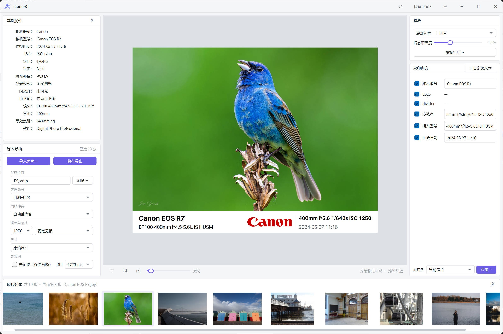
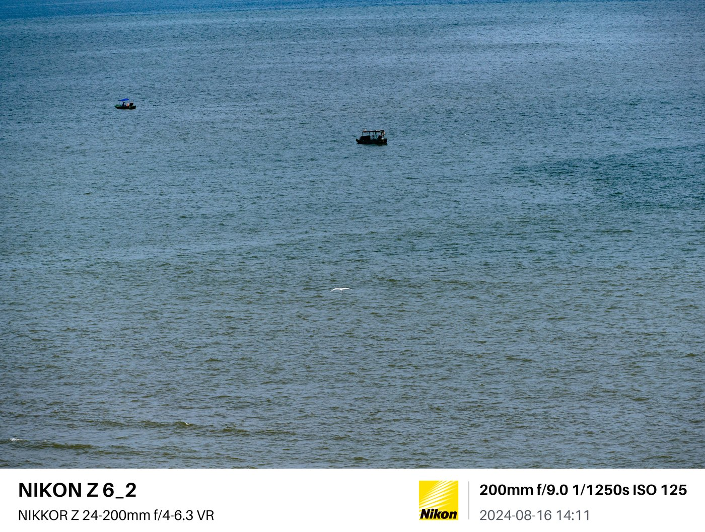
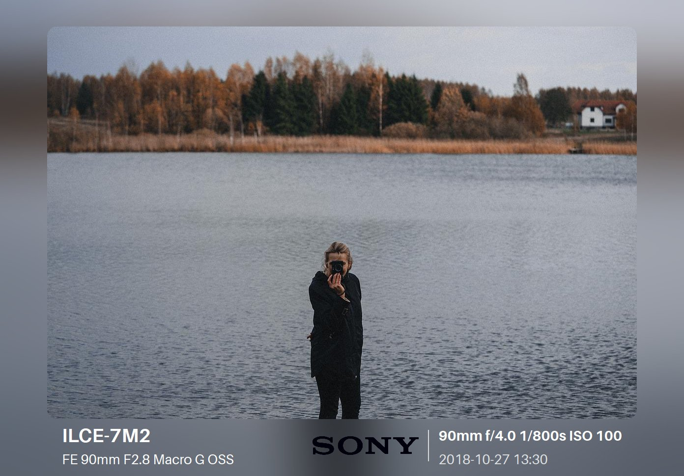
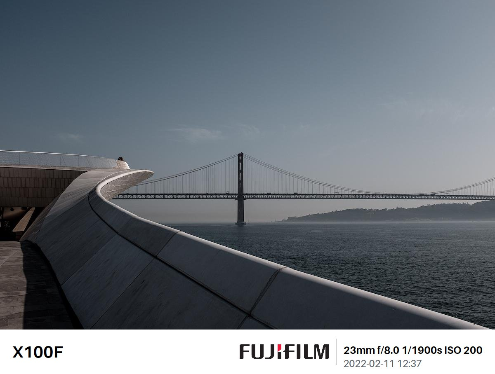

# FrameXT · 照片边框工具（Qt C++）

给照片加相机品牌边框与拍摄信息水印的 Windows 桌面工具：导入照片后自动读取 EXIF，
按相机品牌匹配 Logo、生成拍摄参数水印，套用边框模板一键导出，且完整保留原始元数据。

以 GPLv3+ 开源。当前 2.x 为 Qt C++ 版，前身为 1.x Flutter 版（见[架构沿革](#架构沿革原版-flutter-1x)）。



## 功能特性

- **品牌识别**：读取照片 EXIF，自动匹配内置相机品牌 Logo（Canon / Nikon / Sony /
  Fujifilm / Leica / Hasselblad / OM System / LUMIX 等 20 个品牌条目），未知品牌回落
  兜底标；支持品牌别名映射与用户覆盖层（`brands.json`，便携/安装版数据目录见下文）
- **拍摄信息水印**：机型、镜头、光圈/快门/ISO、焦距、拍摄时间等字段可开关与排版，
  内置传感器尺寸库换算等效焦距
- **边框模板**：内置「底部边框 / 环绕边框 / 高斯模糊」三种版式；模板为 JSON 描述
  （元素、布局、样式），可在模板管理器中导入导出、复制改造
- **元数据保真**：导出时按段级（JPEG）/ 块级（PNG）复制原始元数据、仅精确改写必要
  字段，拍摄信息不丢失
- **导出**：JPEG 质量可调，批量处理
- **多语言**：简体中文（默认）/ 繁体中文 / English
- **双发行**：Inno Setup 安装包 + 免安装便携版（设置与用户数据随程序目录携带）

## 效果示例

| 底部边框 · Nikon Z 6_2 | 高斯模糊 · Sony A7 II | 底部边框 · Fujifilm X100F |
|---|---|---|
|  |  |  |

## 模板定制

模板由 JSON 文件描述，布局全部采用相对单位（信息带高度、字号、Logo 高度均为画布尺寸的
比例），自动适配任意分辨率与宽高比。

- **自己动手**：无需编程——在「模板管理」中复制内置模板调整参数，或导入 / 导出
  `.ftpl` 模板文件分享给他人
- **求助于维护者**：希望新增一种内置版式？欢迎将效果图与想法发送至
  [yfreddy2021@gmail.com](mailto:yfreddy2021@gmail.com)，合适的话会将其制作
  为内置模板随软件分发

## 技术架构

C++20 / Qt 6（Widgets）/ CMake + Ninja / vcpkg（exiv2、libjpeg-turbo）。

分层结构（core 仅依赖 Qt6::Core，由 CMake target 链接关系强制约束）：

| 层 | 目录 | 职责 |
|---|---|---|
| 应用壳 | `src/app` | 主窗口、自绘标题栏、参数面板（`panels/`）、预览画布（`canvas/`）、导入/导出/项目控制器（`controllers/`） |
| 领域层 | `src/core` | 模板/文档模型与 JSON IO（`model/`）、EXIF 读取与格式化 + 品牌/传感器/字段注册表（`metadata/`）、布局引擎与渲染管线（`render/`）、导出引擎与 JPEG 编码（`export/`） |
| 平台层 | `src/platform` | 元数据写回：JPEG 段级 IO、PNG 块级 IO、EXIF IFD 精确编辑、元数据复写器 |
| 测试 | `tests/` | 单元测试、黄金图视觉锚定（`golden/`）、导入/导出性能基准 |

两条关键链路：

- **渲染**：图像解码 → 背景绘制（纯色 / 模糊）→ 元素逐个绘制（Logo、文字）→ 编码，
  全程 QPainter CPU 自绘，无 GPU / Web 依赖；渲染结果有黄金图测试锚定
- **元数据**：读取走 exiv2；写回为自研段级复写（复制原始 JPEG APP 段后仅改写必要
  IFD 字段；PNG 走文本块），避免整段重编码造成的元数据丢失

## 架构沿革（原版 Flutter 1.x）

本项目最初为 Flutter Desktop + Go DLL 架构（1.x）：Flutter 负责界面，图像处理由
Go 编译的 DLL（libvips）完成。2.x 重构为纯 Qt C++：界面与渲染统一为 Qt Widgets +
QPainter 自绘，元数据改用 exiv2，不再依赖 Go 运行时与 libvips。两个版本系相互独立
（1.x 为 Flutter 版，2.x 起 Qt C++ 版），2.x 的用户数据落在 `%APPDATA%\FrameXT`
（安装版）或程序目录 `Data/`（便携版），正常运行无需管理员权限。

## 构建（Windows）

依赖：Qt 6（msvc2022_64 组件）、Visual Studio 2022（「使用 C++ 的桌面开发」工作负载，
构建脚本经 vswhere 自动定位）、CMake ≥3.24 + Ninja（VS 开发者命令行自带）、vcpkg
（manifest 模式，首次配置自动安装 exiv2 / libjpeg-turbo）。

需设置两个环境变量（`setx` 一次即可，重开终端生效）：

```bat
setx QT_ROOT_DIR "C:\Qt\6.8.0\msvc2022_64"
setx VCPKG_ROOT "C:\vcpkg"
```

在 VS2022 开发者命令行（x64）执行：

```powershell
cmake --preset win-debug
cmake --build --preset win-debug
ctest --preset win-debug
```

可执行文件：`build/win-debug/framext.exe`

## 打包（Windows）

在 VS2022 开发者命令行（x64）中执行 `scripts\package-win.bat`，一次产出两种发行物（`dist/`）。
脚本自动探测 VS（vswhere）与 Inno Setup 6（默认安装路径，可用环境变量 `ISCC_EXE` 覆盖），
Qt 路径复用 `QT_ROOT_DIR`：

| 产物 | 说明 |
|---|---|
| `FrameXT-<版本>-setup.exe` | Inno Setup 安装包：简体中文向导、带应用图标、可选桌面快捷方式；用户数据在 `%APPDATA%\FrameXT` |
| `FrameXT-<版本>-portable.zip` | 免安装便携版：解压即用、无需管理员权限；包根的 `FrameXT.portable` 空标记文件使数据（设置 / 品牌别名库 / 自定义模板）落在程序目录 `Data/` 下——整个文件夹可 U 盘携带，删除即卸载 |

便携检测逻辑见 `src/core/AppPaths.cpp`；安装包不含标记文件，行为不受影响。

## 许可

GPLv3 或更高版本（见 LICENSE）。第三方组件与资产：Qt、exiv2、libjpeg-turbo
（各自的开源许可）、思源黑体（SIL OFL 1.1）、Aileron（CC0），许可全文随包存于
`licenses/`。`resources/logos/camera/` 下的品牌 Logo 版权归各相机厂商所有，本项目
仅在品牌识别场景下引用。
